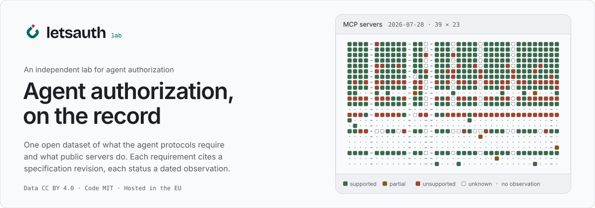
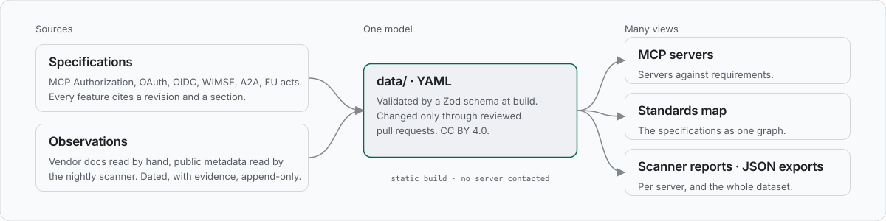

<div align="center">

<picture>
  <source media="(prefers-color-scheme: dark)" srcset="docs/assets/readme/hero-dark.svg">
  <source media="(prefers-color-scheme: light)" srcset="docs/assets/readme/hero-light.svg">
  
</picture>

<br>

**[letsauth.eu](https://letsauth.eu/)** is an open, vendor-neutral lab for how AI agents are authorized.
It covers where MCP, A2A and agent delegation meet OAuth, OpenID Connect and workload identity, with EU law in view.

<br>

[](https://github.com/letsauthlab/letsauth/actions/workflows/ci.yml)
[](https://github.com/letsauthlab/letsauth/actions/workflows/deploy.yml)
[](https://github.com/letsauthlab/letsauth/actions/workflows/scanner-deploy.yml)
[](https://letsauth.eu/)
<br>
[](LICENSE)
[](LICENSE-DATA)
[](https://letsauth.eu/made-in-europe/)
[](https://astro.build/)
[](.nvmrc)
[](package.json)

<br>

[**Open the MCP auth atlas**](https://letsauth.eu/mcp/) ·
[**See the standards map**](https://letsauth.eu/standards/) ·
[**Step through a delegation chain**](https://letsauth.eu/explorer/) ·
[**Read a scanner report**](https://letsauth.eu/mcp/scanner/) ·
[**Get the data**](https://letsauth.eu/mcp/data.json)

</div>

---

## Why this lab exists

Vendors explain agent authorization through their own product. Conformance testers run against one
server, by its owner, pinned to an older revision of the spec. Nobody shows which public MCP
servers validate the issuer, bind the audience or still rely on dynamic client registration, for
all of them and over time. Nobody draws WIMSE, AAuth, ID-JAG, A2A and the EU acts on one map.

letsauth keeps one open dataset of what the agent protocols require and what real servers do:

- **Each requirement cites a revision.** It links to the section of the specification revision it
  comes from. When the spec changes, the atlas says what changed and keeps the old reading.
- **Each status cites an observation.** A cell is a dated observation with a method and evidence a
  reviewer can open. A cell with no observation on record reads *unknown*, and never reads as a
  failure.
- **Open, append-only data.** The dataset is YAML in this repository under CC BY 4.0. We never edit
  an observation, so the atlas also records how servers changed over time.
- **Neutral and passive.** Rows are in alphabetical order and nothing is ranked. The site build
  contacts no server. The scanner reads public metadata only and never sends a token.
- **European.** Hosting, storage and analytics run in the EU. The site covers eIDAS 2.0, the AI
  Act and NIS2 wherever they touch agent delegation.

## What is live

| | | |
|---|---|---|
| 🗺️ | **[MCP auth atlas](https://letsauth.eu/mcp/)** | Which public MCP servers support which features of the MCP Authorization specification: one matrix of servers against requirements, with a page per server, per feature and per revision. Export: [`data.json`](https://letsauth.eu/mcp/data.json). |
| 🕸️ | **[Agent auth atlas](https://letsauth.eu/standards/)** | The specifications, drafts and EU acts behind agent authorization as one map of what builds on, profiles, competes with and replaces what, with maturity and dated revisions per document. Export: [`data.json`](https://letsauth.eu/standards/data.json). |
| 🔗 | **[Delegation chain explorer](https://letsauth.eu/explorer/)** | Scenarios of how authority travels from a person to an agent to an API, step by step, with the decoded token at each hop and toggles for the attacks and misconfigurations that break the chain. Every step cites a specification revision. Export: [`data.json`](https://letsauth.eu/explorer/data.json). |
| 🩻 | **[Breach anatomy](https://letsauth.eu/breaches/)** | Published vulnerabilities and incidents in how agents were authorized, each written from its advisory and traced to the control that was missing, the atlas requirements that stand for it, and a replay toggle in the explorer. Export: [`data.json`](https://letsauth.eu/breaches/data.json). |
| 🔍 | **[Scanner](https://letsauth.eu/mcp/scanner/)** | A passive scanner that reads each listed server's public OAuth metadata every night, checks it against the MCP Authorization specification and opens one pull request of observations. Nothing is graded: the atlas shows each status, and every report counts them per requirement level; one report per server at `/mcp/servers/<id>/scan/` and `/mcp/servers/<id>/scan.json`. |

Next on the [roadmap](docs/roadmap.md): agents under EU rules, and a changelog generated from
the data.

## How it works

<picture>
  <source media="(prefers-color-scheme: dark)" srcset="docs/assets/readme/how-it-works-dark.svg">
  <source media="(prefers-color-scheme: light)" srcset="docs/assets/readme/how-it-works-light.svg">
  
</picture>

One shared model, many views. Specifications, features, servers, observations and the relations
between standards live as YAML under [`data/`](data/). A Zod schema validates them at build time,
and they change only through reviewed pull requests. The build pre-renders the site from that
data. The scanner is the one backend, and its output comes back into the repository as data. The full picture is in
[`docs/architecture.md`](docs/architecture.md).

## Use the data

You can download everything the site shows, under CC BY 4.0:

```sh
curl -s https://letsauth.eu/mcp/data.json | jq '.servers | length'
curl -s https://letsauth.eu/standards/data.json | jq '.relations[0]'
curl -s https://letsauth.eu/explorer/data.json | jq '.scenarios[0].toggles | length'
curl -s https://letsauth.eu/mcp/servers/notion/scan.json | jq '.summary'
```

Or read the YAML directly: one file per entity under [`data/`](data/), with the schema in
[`src/schema/`](src/schema/) and the model explained in [`docs/data-model.md`](docs/data-model.md).

## Contribute

The most useful contribution is an observation: what a server you know does, with evidence a
reviewer can open. Code, specs and relations are welcome too.

- [`CONTRIBUTING.md`](CONTRIBUTING.md): how to add data, specs, relations and code, and what a
  pull request needs.
- [`docs/development.md`](docs/development.md): local setup, commands, tests and screenshots.
- [`docs/architecture.md`](docs/architecture.md): the stack, the repository layout and the data
  flow.
- [`.specify/memory/constitution.md`](.specify/memory/constitution.md): the principles every
  change is checked against.

Security problems go to the private channels in [`SECURITY.md`](SECURITY.md), never to a public
issue.

## Licences

Code is [MIT](LICENSE). Data under `data/` and the JSON exports are
[CC BY 4.0](LICENSE-DATA). [Jan Brennenstuhl](https://www.janbrennenstuhl.eu/) runs the site in
Berlin as Let's Auth Labs. The [imprint](https://letsauth.eu/imprint/) has the details.
